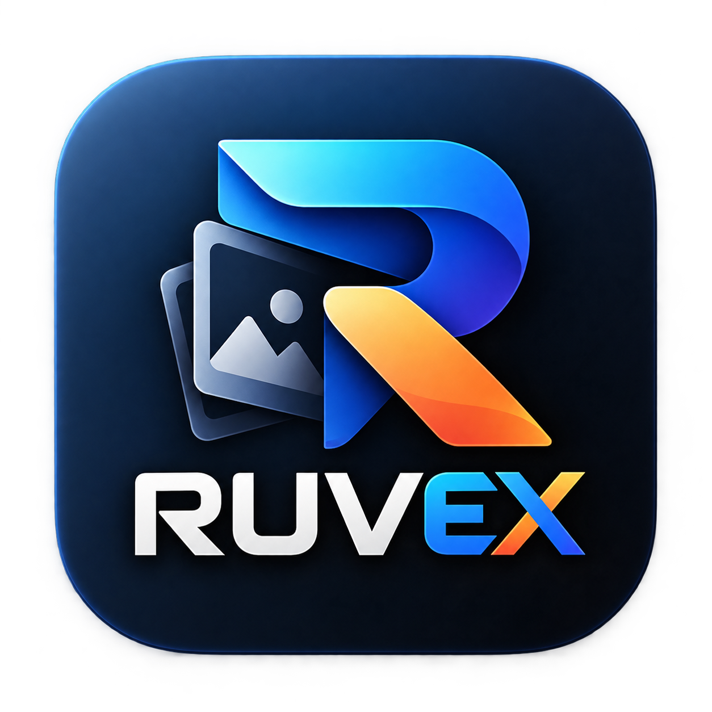

<p align="center">
  
</p>

<h1 align="center">Ruvex</h1>

<p align="center">
  <strong>High-Performance Camera RAW Image Converter (PNG • WEBP • JPEG)</strong>
</p>

<p align="center">
  
  
  
  
</p>

---

## 📖 Overview

**Ruvex** is a fast, multi-threaded camera RAW image converter designed for photographers and content creators. It provides a sleek, modern desktop GUI (CustomTkinter) and a powerful Command-Line Interface (CLI).

Powered by **LibRaw (via `rawpy`)** and **OpenCV**, Ruvex converts RAW images from over 25+ camera formats into high-fidelity **PNG**, **WEBP**, or **JPEG** while preserving sensor color dynamic range, camera EXIF metadata, and directory tree structures.

---

## ✨ Features

- **Multi-Format Export**:
  - **PNG (Lossless)**: 8-bit standard & 16-bit HDR Pro color depth with Level 9 maximum zlib compression.
  - **WEBP**: Compact modern format keeping 100% full native resolution (~2–3.5 MB).
  - **JPEG**: Universal photographic format with customizable quality slider (~3–5 MB).
- **Smart File Size Control**:
  - **`Target < 10 MB (Auto-Fit)`**: Automatically calculates downscaling so every photo stays strictly under 10 MB without manual guesswork.
  - **Resolution Presets**: 40% Scale (~7–8 MB), 35% Scale (~5–6 MB), 2K QHD (2560px), Full HD (1920px), 50% Scale, 75% Scale, Original 100%.
- **Preserve Subfolder Hierarchy**:
  - Option to replicate exact source subfolder trees in the destination folder.
- **Batch & Multi-Folder Processing**:
  - Multi-threaded worker pool (1 to 16 threads).
  - Add individual files or select multiple folders in a single batch.
- **Full Camera EXIF Preservation**:
  - Embeds camera manufacturer, model, lens, ISO, shutter speed, aperture, and timestamp into PNG chunks and JPEG/WEBP EXIF headers.
- **Broad Camera Support (25+ Formats)**:
  - **Canon**: `.CR2`, `.CR3`, `.CRW`
  - **Nikon**: `.NEF`, `.NRW`
  - **Sony**: `.ARW`, `.SRF`, `.SR2`
  - **Adobe / DNG**: `.DNG` (Smartphones, DJI drones, Leica, Pentax)
  - **Fujifilm**: `.RAF` (Bayer & X-Trans)
  - **Panasonic Lumix**: `.RW2`, `.RAW`
  - **Olympus / OM System**: `.ORF`, `.ORI`
  - **Pentax**: `.PEF`, `.PTX`
  - **Hasselblad**: `.3FR`, `.FFF`
  - **Phase One**: `.IIQ`
  - **Leica**: `.RWL`, `.DNG`
  - **Samsung**: `.SRW`
  - **Sigma**: `.X3F`
  - **Epson & Mamiya**: `.ERF`, `.MEF`, `.MOS`

---

## 🚀 Quick Start

### 1. Prerequisites
Ensure you have Python 3.10 or later installed:
```bash
git clone https://github.com/Eldhose-Elsa/Ruvex.git
cd Ruvex
```

### 2. Install Dependencies
```bash
pip install -r requirements.txt
```

### 3. Launch Desktop Application
```bash
python main.py
```
*(On Windows, you can also double-click `run.bat`)*

---

## 💻 Command Line Interface (CLI)

Ruvex comes with a complete CLI for headless environments and batch scripts:

```bash
# Convert a single RAW file to PNG with Target < 10 MB auto-fit
python cli.py "photo.CR2" -o "output_folder" -f PNG -s "Target < 10 MB (Auto-Fit)"

# Convert all photos in multiple directories to WEBP using 8 threads
python cli.py "D:\Photos\Shoot1" "D:\Photos\Shoot2" -o "D:\Export" -f WEBP -t 8

# Convert with subfolder hierarchy preserved
python cli.py "D:\Photos\Wedding" -o "D:\Export" -f JPEG -q 93 -r

# List all supported camera formats by brand
python cli.py --list-formats
```

### CLI Options Reference:
```
usage: cli.py [-h] [-o OUTPUT] [-f {JPEG,PNG,WEBP,JPG}] [-s SCALE]
              [-q JPEG_QUALITY] [-b {8,16}] [-w {Camera,Auto,Daylight}]
              [-c {sRGB,Adobe RGB,ProPhoto RGB,Wide Gamut,Raw}]
              [-d {AHD,AMAZE,DCB,VNG,LINEAR}] [-t THREADS] [-r]
              [--compression COMPRESSION] [--overwrite] [--no-metadata]
              [--list-formats]
              [inputs ...]
```

---

## 🛠️ Building Standalone Windows Executable & Installer

You can build a self-contained `.exe` that runs on PCs without Python:

### Build Standalone Executable (PyInstaller):
```bash
pyinstaller Ruvex.spec
```
The standalone binary will be created in `dist/Ruvex.exe`.

### Build Windows Setup Installer (Inno Setup):
```bash
iscc Ruvex_Installer.iss
```
This generates `Ruvex_Setup.exe` with desktop & start menu shortcuts and clean uninstaller registration.

---

## 📄 License

This project is licensed under the [MIT License](LICENSE).
